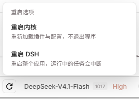

# dsh-restart-switch

[](https://www.npmjs.com/package/dsh-restart-switch)
[](LICENSE)

给 [DeepSeek Harness](https://github.com/deepseek-ai) 用的重启开关：输入框工具栏里一个小按钮，
点开可以选 **重启内核** 或者 **重启 DSH**。



## 两个选项

| 选项 | 做什么 | 代价 |
|---|---|---|
| **重启内核** | 通过实时 HMR 重新组合 profile：重新读取 manifest 与 patch 文件、替换改过的插件模块、启动被停掉的条目、重新判定插件树。之后刷新页面，让浏览器侧加载新的组合。 | 只丢页面状态，Host 进程、HTTP 服务和窗口都不退出。 |
| **重启 DSH** | 重启整个应用。先拉起一个分离的辅助进程，由它关掉桌面外壳、等 Host 优雅收尾，再重新启动应用可执行文件。不在桌面外壳里时，改为重新拉起同一条进程命令。 | 正在运行的任务会中断，菜单里有二次确认。 |

两个动作都会在菜单里显示状态和失败原因——插件坏了或者重启被拒绝时会直接看到，而不是点了没反应。

## 安装

从 npm（在 DSH profile 里）：

```bash
dsh plugin add dsh-restart-switch
```

从 GitHub 装：

```bash
dsh plugin add github:<user>/dsh-restart-switch
```

或者在插件管理里安装本目录：`plugin_manager install_bundle <包的绝对路径>`。

## 按钮位置

触发器注册在 `conversation.input.right`——输入框右下角、发送键左边的紧凑控件区。
最初是写在 `sidebar.footer.action` 的，但接管侧边栏页脚的皮肤（比如 `dsh-claude-style`）
会把页脚里不属于它自己「更新位」的条目全部隐藏，按钮放在那里会看不见。输入框工具栏在任何皮肤下
都会渲染。

菜单本身注册在 `shell.overlay`，不会被任何一列裁掉。

## 配置

| 字段 | 默认值 | 含义 |
|---|---|---|
| `kernelDelayMs` | `120` | RPC 返回后到开始重新组合 profile 的等待时间。 |
| `appDelayMs` | `1500` | RPC 返回后到辅助进程动手的等待时间。 |

在 profile 的 `cordis.patch.yml` 里覆盖：

```yaml
- id: restart-switch
  name: dsh-restart-switch
  config:
    appDelayMs: 2000
```

## 实现

- `index.js` 注册 `restartSwitch` 服务（`restartKernel`、`restartApp`），并把两个方法标记成
  直接的 Remote 端点，页面才能通过 `ctx.connection.rpc` 调用。
- `restartKernel` 用 `ctx.hmr.runExclusive(() => ctx.hmr.reconcileProfile())`，和 DSH 自己在
  profile 文件变化时走的路径完全一致。
- `restartApp` 在拆任何东西之前先把 `relaunch.js` 分离出去。桌面端里辅助进程会关掉 Electron
  进程，等这个 Host 退出（IPC 父进程消失会触发它自己优雅收尾），再重新启动应用。
- `client.js` 注册工具栏触发器和 overlay 菜单，两者共享一个很小的 store。

## 要求

- DSH `0.2.1-rc.5` 及以上的 `0.2.x`（`engines.dsh`）。
- 内核重启需要 profile 启用了实时 HMR；没有 HMR 时菜单会明确报 `kernel-restart-unavailable`，
  不会假装成功。

## 许可证

MIT
